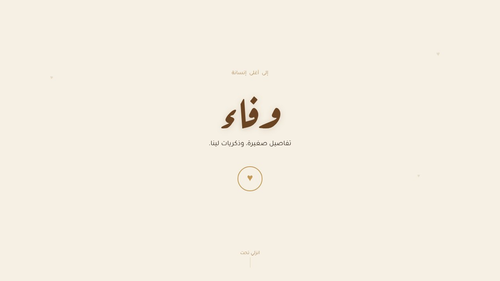

# وفاء

موقع شخصي صغير: ألبومات صور، ألعاب، وكلمتين.

**الموقع:** https://mhmd7710d.github.io/Wafaa/

## فيه إيه
- غلاف هادي بأنيميشن خفيف، وبعده أقسام: «ألبوماتنا»، «ألعابنا»، «كلمتين من قلبي».
- ألبومات صور تتفتح لوحدها، وعارض صور بيتنقل بالسحب.
- لعبة ذاكرة بالصور، وبازل صور.
- زرار مفاجأة، وتأثيرات ظهور مع السكرول.
- متظبط على الموبايل الأول (RTL).

## التقنيات
HTML وCSS وJavaScript عادي، من غير أي مكتبة. الأنيميشن بـCSS و Intersection Observer.

## تشغيل محلي
حمّل الريبو وافتح `index.html` في أي متصفح.

## ملاحظة
مشروع شخصي، والصور فيه خاصة.

## Contact
- LinkedIn: https://www.linkedin.com/in/muhammad-fathi-b7a693424/
- X (Twitter): https://x.com/mouahid7710
- Facebook: https://www.facebook.com/share/1CQhxpCeYL/
- Instagram: https://www.instagram.com/mhmd7710d/
- Email: muhammutfathi@gmail.com
- WhatsApp: https://wa.me/201040428475?text=Hi+Mohammad%2C+I+found+your+project+on+GitHub.
